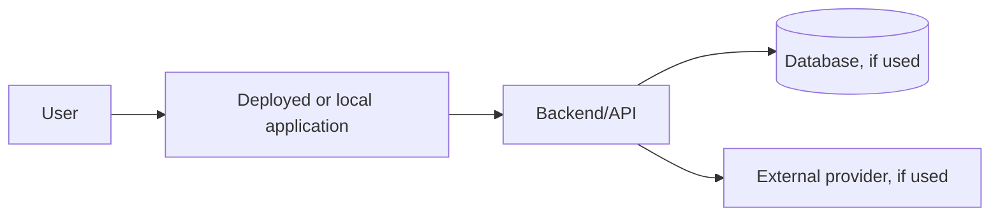

# Project Cloud Engineering & DevOps Evidence Template

Copy these sections into a **real project** README (or link to a longer `docs/CLOUD_ENGINEERING_DEVOPS.md`). Replace every example with verifiable evidence. Do not list a platform simply because it is familiar.

## Cloud Engineering & DevOps

**Status:** local prototype / deployed / production-limited / blocked  
**Last verified:** YYYY-MM-DD  
**Environment:** development / staging / production

### Cloud platforms
- **Hosting:** service name, workload hosted, proof of live deployment or explicit absence
- **Databases:** provider, data stored, migrations, access controls
- **Configuration:** environment management; never expose secrets

### DevOps & CI/CD
- **Source-to-deployment:** exact Git trigger, CI file and build/release steps
- **Validation:** tests/lint/typecheck and latest passing workflow link
- **Containers:** Dockerfile/Compose only if built and run; specify local vs production
- **Terraform / Kubernetes:** include only with applied/tested artifacts; otherwise **not implemented**

### Networking & API engineering
- **External APIs:** provider, request, authentication, timeouts and errors
- **Network controls:** DNS, custom domains, HTTPS/TLS, reverse proxy/ports if applicable
- **Security:** identity, authorization, input validation and rate limiting implemented in code

### Monitoring & reliability
- **Observability:** log sources, health endpoints, alerts/metrics only where actually functioning
- **Failure handling:** retry behavior, idempotency, dead letters/incident procedures where present
- **Recovery:** real backup and restore evidence only, otherwise **unverified**

### Architecture diagram

**Deployment:** valid live URL, or "Local only — no public production deployment."  
**Implementation:** links to relevant files, actual commit or PR  
**Tests / CI:** links to exact GitHub Actions run and test report  
**Troubleshooting:** short incident narrative: symptom → evidence → diagnosis → fix → retest  
**Known limitations:** what is incomplete/blocked/unverified

## Verification checklist

- [ ] The described behavior exists in source code.
- [ ] Hosted services really ran, not just described in README.
- [ ] Live URL resolves, where one is claimed.
- [ ] Latest test results match the cited workflow/report.
- [ ] No screenshots or demos are described as real transactions unless independently checkable.
- [ ] No secrets or internal account identifiers are committed.
- [ ] Avoid fake "100% uptime", "zero downtime", scale or speed claims.
- [ ] Separate **learned about**, **implemented locally**, **deployed**, and **operated**.
